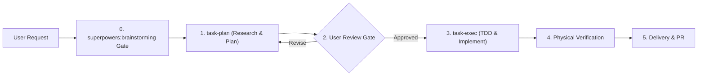

# Pipeline Topic (`pipeline.md`)

## 1. Universal Task Pipeline

The pipeline connects `task-plan` and `task-exec` into a single, cohesive workflow:

---

## 2. Stage Breakdown

### Stage 0: Prerequisite Brainstorming Gate (`using-superpowers` & `brainstorming`)
1. **Prerequisite Check (HARD STOP)**: Before entering Stage 1 `task-plan`, verify whether prior brainstorming has been conducted. If not, invoke `superpowers:brainstorming` first.
2. **Request Classification**: Classify into **Spike** (feasibility/question), **Bounded** (existing-flow code change), or **Architectural** (new subsystems/interfaces) and announce the path.
3. **Intent & Constraints Alignment**: Explore user intent, success criteria, and trade-offs before generating plan artifacts.

### Stage 1: Planning & Research (`task-plan`)
1. **Pre-search & Tracker Reconciliation**: Run RAG and Qdrant memory lookups to find previous architectural decisions. **Cross-verify findings with workspace backlog trackers (Plane SSOT and `fix_plan.md`) and live system evidence** to ensure decision premises remain valid before proposing actions.
2. **Research**: Trace root causes and evaluate technical alternatives.
3. **Draft Deliverable**: Author a 3-tier deliverable (`roadmap-*.md`, `plan-*.md`) containing the 8 mandatory sections.
4. **User Review Gate**: Obtain explicit approval for the initial plan or changed scope. Reuse existing attributable approval for unchanged scope; do not repeat settled decisions.

### Stage 2: Execution & Implementation (`task-exec`)
1. **Gate Check**: Verify plan approval and active worktree state.
2. **Implementation**: Execute TDD Red-Green-Refactor cycle for code changes, or use doc/mail adapters for non-coding tasks.
3. **Physical Verification**: Run automated tests, frontmatter linters, and regression suites to ensure 100% Green status.
4. **Delivery**: Group logical units via `commit-tidy` and deliver only within existing authority. Local-only scope ends at local evidence/commits; publication and acceptance remain separate.

## 3. Detour and Resume Checkpoint

A correction, FA record, recovery, or status inquiry is not cancellation of the
original task. Before resuming, recover the original goal, owner scope, approved
revision/reference, authorized actions and resources, next unfinished action,
pending decisions, and true blockers from existing receipts and current source.
A recovery record is a checkpoint, not a replacement deliverable.

- **Continue within authority**: Continue the next authorized action in the same
  task after required correction checks pass. Create an absent authorized
  deliverable and verify it; an FA record alone never completes the original goal.
  Preserve existing explicit approval; use [review](../task-plan/review.md) only
  for a genuinely missing decision or changed scope.
- **Honor limits**: If the user explicitly selected record-only work or cancelled
  the original goal, do not resume it. Report stopped or pending accurately.
- **Unavailable prerequisite**: Block only the dependent action when a provider,
  host, or resource is unavailable; continue independent authorized work.
  Do not claim a provider workaround that was not performed and verified.
- **Unknown effects**: If a prior action lacks authoritative settlement, use
  read-only recovery through its existing owner before another mutation.
  No blind replay or duplicate worker launch. Do not substitute dispatch/start
  receipts for execution, verification, or acceptance.

Keep native owner statuses native. Do not add a scheduler, persistence service,
worker launch, or shared runtime schema to this checkpoint. Finish through the
existing [verification](../task-exec/verify.md) and
[delivery](../task-exec/delivery.md) owners; resolving the detour is not original
completion.
